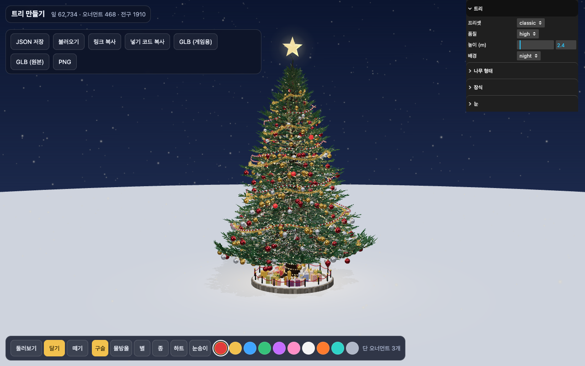
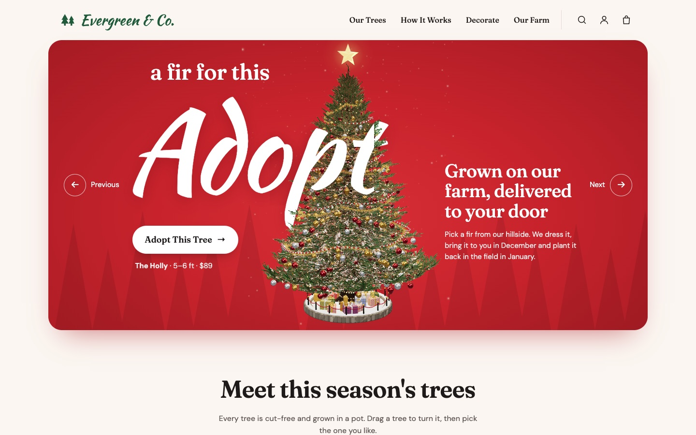
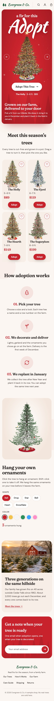
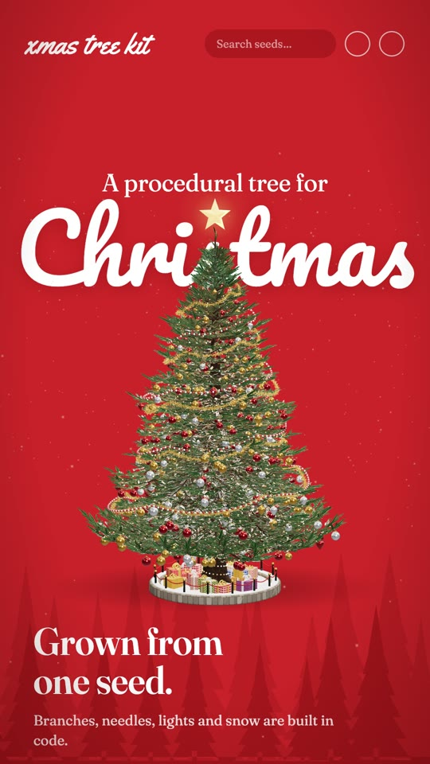

# xmas-tree-kit

English · [한국어](README.ko.md)

A three.js library that grows a fir tree from a single seed and decorates it with ornaments, lights, garland and presents. You can use a tree in three ways:

- add it to a three.js scene or web game with `scene.add(tree)`
- show it on any web page with one `<xmas-tree>` tag
- export it as GLB for Unity, Godot, Unreal or Blender

The tree and decoration code was taken from the 20 m tree in the [Christmas Town](https://town.honeycake.io) plaza.

Demo: [Tree Maker](https://gykim80.github.io/xmas-tree-kit/editor/) · [Sample shop](https://gykim80.github.io/xmas-tree-kit/examples/adopt/) · [Embed example](https://gykim80.github.io/xmas-tree-kit/examples/embed.html) · [Game example](https://gykim80.github.io/xmas-tree-kit/examples/game.html)



## Install

The package isn't on the npm registry. Install it straight from git. `dist/` is committed, so nothing needs to be built after install.

```bash
npm install three github:gykim80/xmas-tree-kit
# pin a version
npm install three github:gykim80/xmas-tree-kit#v0.2.0
```

three is a peer dependency (0.160 or newer).

## Quick start

### 1. In a three.js scene

```js
import { ChristmasTree } from 'xmas-tree-kit';

const tree = new ChristmasTree({ preset: 'cozy', size: 2.4 }); // size is in meters
scene.add(tree);
```

There is nothing to call per frame. Light twinkle, the camera-facing star and distance-based needle LOD all run when the tree renders. Metallic ornaments need an environment map (`scene.environment`); the examples use `RoomEnvironment`.

### 2. On a web page

One script, no build step. This file bundles three.

```html
<script type="module" src="https://cdn.jsdelivr.net/gh/gykim80/xmas-tree-kit@v0.2.0/dist/xmas-tree.standalone.js"></script>

<xmas-tree preset="classic" camera-controls auto-rotate snowfall style="height:480px"></xmas-tree>
```

With a bundler:

```js
import 'xmas-tree-kit/element'; // registers <xmas-tree>
```

### 3. Into a game engine

```js
import { ChristmasTree, exportGLB } from 'xmas-tree-kit';

const tree = new ChristmasTree({ preset: 'classic', quality: 'low', size: 3 });
const glb = await exportGLB(tree); // ArrayBuffer
```

The `GLB (game)` button in Tree Maker does the same.

## Tree Maker

```bash
npm install
npm run dev     # http://localhost:5320/editor/
```

- The panel on the right changes preset, quality, height, shape, decorations and snow cover
- Pick `Hang` in the bottom bar and click the tree to hang an ornament with the chosen shape and color. `Remove` takes one off
- `Save JSON` and `Open` move a tree in and out as a file
- `Copy link` puts the tree in the URL (`#t=…`). Opening that URL shows the same tree
- `Copy embed code` copies HTML that shows the current tree
- `GLB (game)` regrows the tree at low quality before export. `GLB (full)` exports what you see

## Sample site: a tree adoption shop

[](https://gykim80.github.io/xmas-tree-kit/examples/adopt/)

[Open the sample shop](https://gykim80.github.io/xmas-tree-kit/examples/adopt/). Evergreen & Co. is a made-up farm that rents out real firs for the season. It shows how the trees fit into an ordinary shop page instead of a dark 3D viewer:

- the hero tree stands in front of a red card, between two copies of the script word "Adopt", so the text wraps around it. `Previous` and `Next` swap the preset
- each product card is its own `<xmas-tree>` with a transparent background. Drag one to turn it
- in "Hang your own ornaments" visitors pick a shape and color and click the tree. The count comes from the `ornamentadd` event
- `Adopt` opens a dialog and adds the tree to the bag

The whole page is plain HTML, CSS and about 150 lines of JS in [`examples/adopt/`](examples/adopt/). Two tricks worth copying:

```html
<!-- transparent tree over your own background, no ground disc -->
<xmas-tree preset="classic" background="transparent" ground="false" camera-controls auto-rotate snowfall></xmas-tree>
```

```js
// the tag lights trees for a night sky; warm the lights up for a light page and free the wheel for scrolling
el.addEventListener('load', () => {
  for (const o of el.viewer.scene.children) {
    if (o.isHemisphereLight) o.intensity = 1.1;
    if (o.isDirectionalLight) o.color.set('#fff0d8');
  }
  el.viewer.controls.enableZoom = false;
});
```

The layout started from a GPT mockup ([docs/adopt-mockup.jpg](docs/adopt-mockup.jpg)). The trees in the page are rendered live; the farm photo is the only generated image.

<details><summary>Phone layout</summary>



</details>

## Options

```js
new ChristmasTree({
  preset: 'classic',   // classic · cozy · nordic · rainbow · candy · snowy · bare
  size: 2.4,           // final height (m)
  quality: 'high',     // ultra · high · medium · low
  seed: 1225,          // same seed, same tree

  tree: { spread: 7, droop: 0.36, ... },     // shape (table below)
  decor: { palette: 'red-gold', ... },       // decorations (table below)

  snow: 0.5,           // snow resting on branches, 0–1
  glow: 3,             // light brightness
  twinkle: 2.2,        // twinkle speed (0 = steady)
  shadows: true,       // cast shadows
  lod: true,           // fewer needles when far away
  prepass: false,      // needle depth prepass (faster needles on mobile GPUs)
  ornaments: [],       // hung ornaments (the `ornaments` field of toJSON())
});
```

Keys that belong in `tree` or `decor` (`seed`, `spread`, `palette`, `lights` …) can also be passed at the top level. Values you set yourself are never reduced by the quality setting.

### Shape (`tree`)

| Name | Default | Meaning |
| --- | --- | --- |
| `seed` | 1225 | Random seed |
| `spread` | 7.0 | Length of the lowest branches (design height 20) |
| `whorls` | 56 | Branch tiers |
| `branchesPerWhorl` | 10 | Branches per tier |
| `droop` | 0.36 | Branch droop |
| `upturn` | 0.55 | Upturn at branch tips |
| `twigs` | 1.0 | Twig density |
| `needles` | 1.0 | Needle density |
| `needleSize` | 1.55 | Needle cluster size |
| `clearTrunk` | 3.2 | Bare trunk height below the first branches |
| `trunkRadius` | 0.62 | Trunk radius |

Trees are always grown at height 20 and then scaled to `size`, so a 2 m tree and a 20 m tree have the same proportions.

### Decorations (`decor`)

| Name | Default | Meaning |
| --- | --- | --- |
| `ornaments` | 620 | Number of auto-placed ornaments |
| `ornamentSize` | 1 | Ornament size multiplier |
| `ornamentShapes` | `{ ball: 0.78, drop: 0.22 }` | Shape weights. ball · drop · star · bell · heart · snowflake |
| `palette` | `'classic'` | classic · red-gold · silver-blue · rainbow · candy · forest, or an array of colors |
| `lights` | 2200 | Number of lights |
| `lightColor` | `'warm'` | warm · cool · multi · red-green, or an array of colors |
| `trunkLights` | true | Light string wound around the bare trunk |
| `garland` / `garlandColor` | true / `#f0c25a` | Tinsel garland |
| `beads` / `beadColors` | true / white and red | Bead string |
| `topper` / `topperColor` | `'star'` / `#ffd76a` | Star on top (`'none'` for no topper) |
| `presents` | 26 | Number of presents |
| `base` | `'bed'` | bed (stone planter) · skirt (tree skirt) · none |
| `skirtColor` | `#9c1018` | Tree skirt color |
| `glowLights` | true | Point lights in the star and inside the tree. Turn off when you place many trees |

### Needle clusters per quality (classic, approx.)

| Quality | Needle clusters | Lights | Use |
| --- | --- | --- | --- |
| ultra | 128,000 | 2,350 | One hero tree on screen |
| high | 63,000 | 1,900 | Default |
| medium | 31,000 | 1,360 | Several trees, phones |
| low | 14,000 | 850 | Forests, game GLB |

## Hanging ornaments

A spot is `{ h, a }`: `h` is the height ratio (0 = ground, 1 = top) and `a` is the angle around the trunk in radians. If the tree changes size or shape, ornaments move with its outer surface.

```js
tree.addOrnament({ shape: 'star', color: '#f2c14e', h: 0.6, a: 1.2 });

// hang where the user clicked
const spot = tree.surfacePoint(ndc, camera); // { h, a, point } or null
if (spot) tree.addOrnament({ shape: 'heart', color: '#e23b3b', h: spot.h, a: spot.a, data: { from: 'Mina', wish: 'A snowy day' } });

// fly in from a hand
tree.addOrnament({ shape: 'bell', color: '#3fa4ff', h: 0.4, a: 2 }, { from: handWorldPosition });

// pick and remove
const hit = tree.pickOrnament(ndc, camera); // a Raycaster works too
if (hit) tree.removeOrnament(hit.id);

tree.addEventListener('ornamentadd', (e) => save(e.ornament));
tree.addEventListener('ornamentarrive', (e) => sparkle(tree.ornamentPosition(e.ornament)));
```

`data` can hold anything and is saved with `toJSON()`, so you can send a visitor's wish, name or timestamp to your server.

## Save and load

```js
const json = tree.toJSON();
// { format: 'xmas-tree-kit', version: 1, preset: 'cozy', size: 2.4, quality: 'high', tree: {...}, ornaments: [...] }

const copy = ChristmasTree.fromJSON(json);
```

Only the preset name and changed values are stored. A tree with 300 ornaments that each carry a short wish is about 30 KB.

## Promo video

[](https://github.com/gykim80/xmas-tree-kit/releases/download/v0.2.0/xmas-tree-kit-promo-v2.mp4)

[Watch the promo (MP4, 34 s)](https://github.com/gykim80/xmas-tree-kit/releases/download/v0.2.0/xmas-tree-kit-promo-v2.mp4). `promo/` holds a 34-second vertical (1080×1920) promo styled like a holiday shop landing page: a red hero with the tree growing through a script "Christmas", seeds, presets, hanging ornaments, a decorating checklist and the ways to ship a tree, cut to the "Jingle Bells" chorus at 120 BPM. The storyboard is in `promo/STORYBOARD.md`. Every frame is rendered by this library on a fixed clock, and the soundtrack is synthesized in `promo/music.mjs`.

```bash
npm run dev          # preview at http://localhost:5320/promo/
npm run promo        # render promo/out/xmas-tree-kit-promo.mp4 (needs ffmpeg)
```

## Recording and fixed time

`tree.update(seconds)` switches the tree to a clock you control. Light twinkle, the star and ornament animations all follow that time, so frames are the same on every run. The promo video above is rendered this way.

## `<xmas-tree>` attributes

| Attribute | Meaning |
| --- | --- |
| `preset` `seed` `size` `quality` | Tree |
| `palette` `light-color` `lights` `ornaments` `presents` `topper` `base` `garland` `beads` | Decorations |
| `snow` `glow` `twinkle` | Applied right away without regrowing |
| `background` | night · evening · day · transparent · `#color` |
| `camera-controls` | Drag to orbit, wheel to zoom |
| `auto-rotate` | Slow spin. Stops on touch, resumes after 6 s |
| `snowfall` | Falling snow |
| `ground` | Ground disc (`false` to hide, or a color) |
| `src` | URL of a saved JSON tree |
| `decorate` | Click to hang an ornament. Shift-click removes |
| `ornament-shape` `ornament-color` | Shape and color to hang (random per click when unset) |

```js
const el = document.querySelector('xmas-tree');
el.config = savedJson;        // anything attributes can't express
el.tree;                      // the ChristmasTree
el.addEventListener('ornamentadd', (e) => fetch('/api/ornaments', { method: 'POST', body: JSON.stringify(e.detail.ornament) }));
await el.toBlob();            // PNG
await el.downloadGLB('tree.glb');
```

Rendering pauses while the element is scrolled out of view.

## In a game

```js
const tree = new ChristmasTree({ preset: 'classic', size: 6 });
scene.add(tree);

// collision: trunk radius and crown radius in world units
const { trunkRadius, crownRadius, height } = tree.footprint;

// forest: low quality, no point lights, shadows on a few trees only
for (let i = 0; i < 30; i++) {
  const t = new ChristmasTree({ preset: 'snowy', quality: 'low', size: 4, seed: i, shadows: i % 3 === 0 });
  t.position.set(...);
  scene.add(t);
}
```

`examples/game.html` lets you walk a forest in first person and hang ornaments where the crosshair points.

### GLB export options

```js
exportGLB(tree, {
  bake: true,        // bake instances into plain meshes (default)
  needleRatio: 1,    // share of needle clusters to export
  lights: false,     // include point lights
  userOrnaments: true,
});
```

| Engine | `bake: true` | `bake: false` (EXT_mesh_gpu_instancing) |
| --- | --- | --- |
| Godot 4 | Yes | Not supported |
| Unity (glTFast) | Yes | Yes, smaller file |
| three.js · Babylon.js | Yes | Yes |

Snow cover and twinkle are shaders and can't be stored in the file. Lights are exported as glowing unlit material.

## Lower-level API

You can use the pieces without `ChristmasTree`.

```js
import { buildTree, buildDecorations, createUniforms, createOrnamentLayer } from 'xmas-tree-kit';

const uniforms = createUniforms({ snow: 0.4 });
const fir = buildTree({ seed: 3, whorls: 30 }, uniforms);           // an undecorated fir
const decor = buildDecorations(fir, { palette: 'forest' }, uniforms); // decorations fitted to it
```

`buildTree` also returns ornament spots (`anchors`), light spots (`tips`) and the crown radius per height (`envAt(y)`), for hanging your own decorations.

## Development

```bash
npm run dev          # Tree Maker and examples
npm test             # unit tests in Node (no DOM)
npm run check        # headless browser checks, screenshots in tmp/shots/
npm run build        # dist/ (library, web component, one-script file)
npm run build:site   # site-dist/ (static Tree Maker and examples)
npm run promo        # renders the vertical promo video to promo/out/
```

To release, run `npm run build`, commit `dist/` and tag. git installs and jsDelivr use that `dist/` as is.

Design notes and the projects this borrows from are in [docs/design.md](docs/design.md).

## License

MIT
